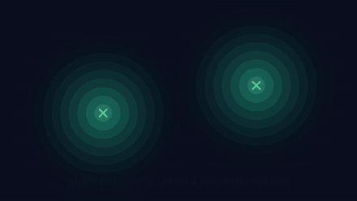
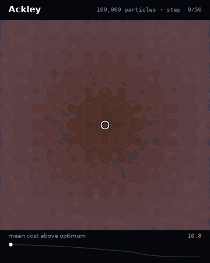
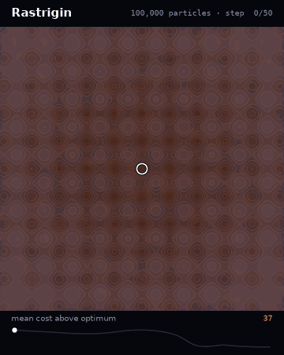
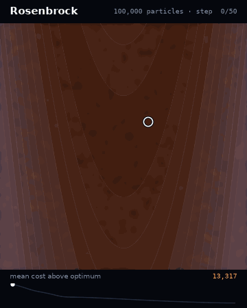
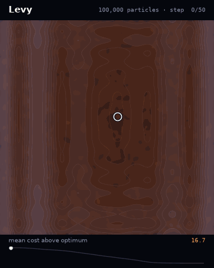
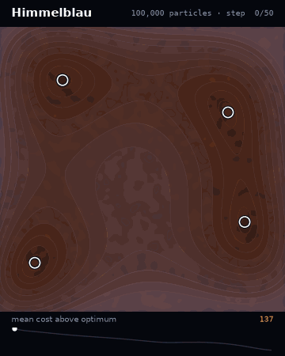
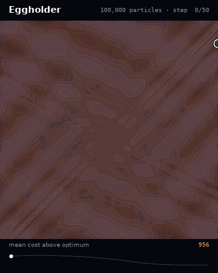
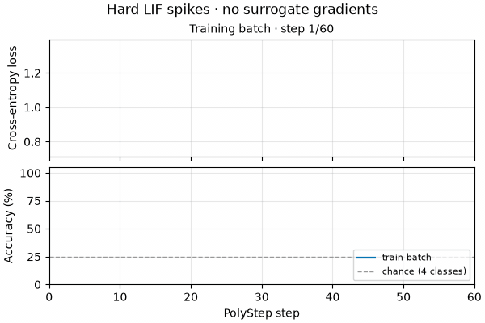
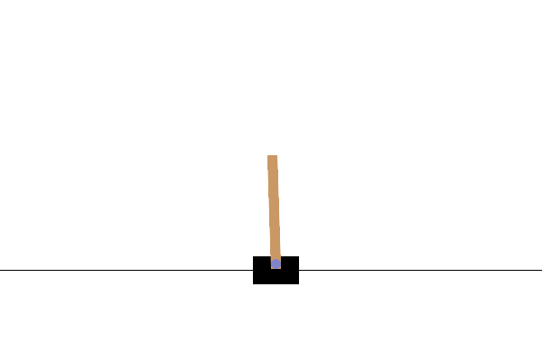

# polystep

[](https://pypi.org/project/polystep/)
[](https://arxiv.org/abs/2605.01928)
[](https://www.python.org/downloads/)
[](https://pytorch.org/)
[](https://github.com/anindex/polystep/blob/main/LICENSE)

Gradient-free neural network training via optimal transport.

Accepted at [Transactions on Machine Learning Research (TMLR)](https://openreview.net/forum?id=8mlcqTTMuU).

PolyStep tests parameter changes within a finite radius. It then updates the parameters
using a weighted average of these candidates, called a barycenter. I use it for spiking
networks, quantized layers, hard routing, and other models without useful gradients. For differentiable models,
backpropagation is usually faster.

Version 1.2.0. See the [changelog](https://github.com/anindex/polystep/blob/main/CHANGELOG.md) for release changes.

[Paper](https://arxiv.org/abs/2605.01928) ·
[Interactive visualization](https://vietngth.github.io/polystep-visualization/) ·
[API reference](https://github.com/anindex/polystep/blob/main/docs/api_overview.md) ·
[Julia package](https://github.com/anindex/PolyStep.jl)

| One particle | Four particles, two minima |
|:---:|:---:|
| [](https://vietngth.github.io/polystep-visualization/) | [](https://vietngth.github.io/polystep-visualization/) |

Animations from [Viet T. Nguyen's interactive visualization](https://vietngth.github.io/polystep-visualization/).

| Ackley | Rastrigin | Rosenbrock |
|:---:|:---:|:---:|
|  |  |  |
| **Levy** | **Himmelblau** | **Eggholder** |
|  |  |  |

Each panel moves 100,000 particles using function values alone. The glow shows particle
density. Rings mark the global minima, and the curve below shows the mean cost above
the optimum. A step takes 40 to 70 ms on one CPU thread and 6 to 11 ms on an RTX 5090.
On that GPU, 1,000,000 particles take 7 to 13 ms per step.
[`examples/12_particle_gallery.py`](https://github.com/anindex/polystep/blob/main/examples/12_particle_gallery.py) draws the animations.
Use `--particles` to set the particle count and `--device` to select the device.

## Installation

```bash
pip install polystep
pip install "polystep[examples]"  # dependencies for the repository's examples
```

Python 3.11+ and PyTorch 2.8+ are required. Choose a CUDA build compatible with your
driver from the [PyTorch installation guide](https://pytorch.org/get-started/locally/).
For development, run `pip install -e ".[dev]"` from a checkout.

## Quickstart

```python
import torch
from torch import nn
from torch.utils.data import DataLoader, TensorDataset
from polystep import HybridSubspace, ParamLayout, PolyStepOptimizer, TrainConfig, train

torch.set_num_threads(1)
model = nn.Sequential(nn.Linear(16, 32), nn.ReLU(), nn.Linear(32, 3))
loader = DataLoader(
    TensorDataset(torch.randn(256, 16), torch.randint(0, 3, (256,))),
    batch_size=32,
)
subspace = HybridSubspace.from_layout(
    ParamLayout.from_module(model), rank=4, max_subspace_dim=128,
)
optimizer = PolyStepOptimizer(model, subspace=subspace, solver="softmax")
train(model, loader, nn.CrossEntropyLoss(), optimizer, TrainConfig(epochs=5))
```

`max_subspace_dim=128` caps the search at 128 coordinates, so each step scores
144 candidates. Biases and normalization weights keep their full width. On a larger
model, the cap must cover those parameters plus at least one coordinate per weight
matrix. If the cap is too small, PolyStep warns and reports the minimum dimension it
can use.

`step_batch` uses the same candidate evaluation paths as `train()`:

```python
loss_fn = nn.CrossEntropyLoss()
for x, y in loader:
    optimizer.step_batch(x, y, loss_fn=loss_fn)
optimizer.release_evaluator()
```

`torch.set_num_threads(1)` avoids thread overhead for a model this small. Larger
models may benefit from more threads; `python -m polystep.benchmarks.threads` compares
several counts on an MLP workload. See
[performance](https://github.com/anindex/polystep/blob/main/docs/performance.md)
for candidate paths, thread counts, compilation, and memory settings.

### Forward-pass gradients

`ProbeGradient` estimates gradients for supported `nn.Linear` and `nn.Conv2d` layers
from forward passes. It writes them to `.grad`, so a standard optimizer can update
the weights:

```python
from polystep import ProbeGradient

estimator = ProbeGradient(model, probes=64, probe_radius=0.1)
optimizer = torch.optim.SGD(model.parameters(), lr=0.1, momentum=0.9)
loss_fn = nn.CrossEntropyLoss(reduction="none")
for inputs, targets in loader:
    estimator(inputs, targets, loss_fn=loss_fn)
    optimizer.step()
```

For linear layers, it probes each sample's outputs. For convolutions, it probes weight
entries. With a fixed probe budget, the number of forward passes does not grow with
layer width. A sufficiently large probe can cross a hard threshold, which lets it train
sign and spiking networks. On MNIST with an RTX 5090,
[example 13](https://github.com/anindex/polystep/blob/main/examples/13_probe_gradient.py) reaches 98.0% test accuracy with a
ReLU MLP in 3 s, 96.8% with sign activations in 3 s, and 97.1% with hard-threshold
spiking neurons in 8 s. The loss must return one value per sample. See the
[API reference](https://github.com/anindex/polystep/blob/main/docs/api_overview.md#probegradient).

### Ask/tell

```python
from polystep import PolyStepES

es = PolyStepES(dim=20, epsilon=0.1, step_radius=0.3)
for _ in range(300):
    candidates = es.ask()
    es.tell((candidates - 1).square().sum(dim=1))
print(es.best_fitness, (es.mean - 1).square().sum().item())
```

### Synthetic objectives

```python
import torch
from polystep import Ackley
from polystep.solver import PolyStep

solver = PolyStep.create(Ackley(dim=10), epsilon=0.5, max_iterations=50)
state = solver.run(torch.randn(100, 10))
```

## Method

Each step samples a rotated polytope, evaluates its vertices, computes transport
weights, and moves to their barycenter. Subspaces reduce the number of coordinates
searched. Softmax normalizes each particle's vertex weights; Sinkhorn also enforces
the target marginal.

Finite-radius probes can cross flat regions of discontinuous losses. Performance
depends on the radius, representation, and evaluation budget. PolyStep's optional
quadratic models and radius controllers are implementation heuristics; they do not
inherit classical direct-search or trust-region guarantees.

| SNN training | CartPole policy |
|:---:|:---:|
|  |  |

The [SNN example](https://github.com/anindex/polystep/blob/main/examples/02_snn_starter.py) trains a network with hard LIF spikes
on four synthetic classes, without surrogate gradients.

The [CartPole example](https://github.com/anindex/polystep/blob/main/examples/03_rl_cartpole.py) uses real-valued weights and a
hard left/right `argmax`. PolyStep optimizes episode return without gradients
through the actions or simulator.

## Baselines

`polystep.baselines` provides `openai_es`, `spsa`, `mezo`, `random_search`, `eggroll`,
and `cma_es`, which needs `pip install cma`. One evaluation means one candidate
scored, even when candidates are batched:

```python
from polystep.baselines import Objective, openai_es

objective = Objective(lambda x: (x - 1).square().sum(1), dim=64, budget=10_000)
result = openai_es(objective, sigma=0.05, popsize=32)
```

The paper runners match search spaces, budgets and tuning as the
[reproducibility guide](https://github.com/anindex/polystep/blob/main/docs/reproducibility.md#protocol) describes.

## Benchmarks

Results are means ± sample standard deviations over five seeds. Configurations and
checkpoints are selected on validation data. The probSAT and RC2 columns are single
runs. Each baseline uses a matched evaluation or step budget, as the
[protocol](https://github.com/anindex/polystep/blob/main/docs/reproducibility.md#protocol)
describes. The tables were recorded before 1.0; the
[reproducibility guide](https://github.com/anindex/polystep/blob/main/docs/reproducibility.md#changes-since-the-published-tables)
lists the rows that later releases change, and the
[experiment index](https://github.com/anindex/polystep/blob/main/experiments/EXPERIMENT_INDEX.md)
has the full tables.

<!-- BENCH:START -->

### Non-differentiable tasks

Test accuracy %. A dash means the method was not run on that task.

| Task | PolyStep | CMA-ES | OpenAI-ES | SPSA | Adam (surrogate) | Non-diff op |
|---|---|---|---|---|---|---|
| SNN/LIF (MNIST) | 93.0 ± 0.2 | 77.1 ± 13.3 | 79.6 ± 5.2 | 53.9 ± 3.0 | 86.3 ± 10.6 | `threshold()` |
| Int8 quantized | 97.0 ± 0.1 | 91.6 ± 0.4 | 94.4 ± 0.2 | 82.5 ± 0.5 | 97.8 ± 0.1 | `round()` |
| Argmax attention | 86.6 ± 0.4 | 79.5 ± 0.5 | 80.0 ± 0.4 | 67.4 ± 1.3 | 88.6 ± 0.1 | `argmax()` |
| Staircase activation | 94.3 ± 0.1 | 89.2 ± 0.4 | 88.9 ± 0.5 | 45.2 ± 4.2 | 97.5 ± 0.1 | `floor()` |
| Hard MoE routing | 90.6 ± 0.2 | 77.8 ± 1.5 | 82.5 ± 0.8 | 25.4 ± 3.5 | - | `argmax()` |

### MAX-SAT (% clauses satisfied)

| Variables | PolyStep | CMA-ES | OpenAI-ES | probSAT | RC2 |
|---|---|---|---|---|---|
| 100 | 98.0 ± 0.7 | 99.0 ± 0.3 | 99.4 ± 0.1 | 99.8 | 99.8 |
| 5,000 | 98.1 ± 0.1 | 95.2 ± 0.2 | 92.9 ± 0.2 | 99.9 | timeout |
| 100,000 | 98.1 ± 0.0 | 90.7 ± 0.1 | 88.9 ± 0.0 | 99.6 | timeout |

### Differentiable sanity checks

| Task | PolyStep | Adam |
|---|---|---|
| MNIST (2-layer MLP) | 96.8 ± 0.1 | 97.7 ± 0.1 |
| ETTh1 (LSTM, MSE; lower is better) | 0.253 ± 0.023 | 0.247 ± 0.023 |
<!-- BENCH:END -->

The SNN surrogate-gradient baseline varies substantially across seeds. Adam leads
on the differentiable tasks, and specialized solvers lead on MAX-SAT. See
[limitations](https://github.com/anindex/polystep/blob/main/LIMITATIONS.md)
for unsupported configurations and comparison limits.

## Documentation

- [API reference](https://github.com/anindex/polystep/blob/main/docs/api_overview.md)
- [Performance](https://github.com/anindex/polystep/blob/main/docs/performance.md)
- [Examples](https://github.com/anindex/polystep/blob/main/examples/README.md)
- [Experiments](https://github.com/anindex/polystep/blob/main/experiments/README.md) and [reproduction](https://github.com/anindex/polystep/blob/main/docs/reproducibility.md)
- [Limitations](https://github.com/anindex/polystep/blob/main/LIMITATIONS.md)
- [Determinism](https://github.com/anindex/polystep/blob/main/docs/determinism.md)
- [Contributing](https://github.com/anindex/polystep/blob/main/CONTRIBUTING.md) and [changelog](https://github.com/anindex/polystep/blob/main/CHANGELOG.md)

## Citation

```bibtex
@article{le2026training,
  title={Training Non-Differentiable Networks via Optimal Transport},
  author={Le, An T},
  journal={Transactions on Machine Learning Research},
  year={2026},
  url={https://openreview.net/forum?id=8mlcqTTMuU}
}
```

## Acknowledgments

Thanks to [Viet T. Nguyen](https://vietngth.github.io/) for the
[interactive visualization](https://vietngth.github.io/polystep-visualization/).

## License

[Apache-2.0](https://github.com/anindex/polystep/blob/main/LICENSE).
